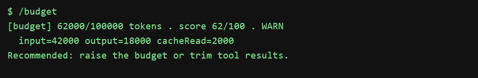

# dsh-plugin-token-budget

**一条命令看清这次 DSH 会话消耗了多少 token，以及是否还在预算之内。**

成本看板是事后展示账单；`token-budget` 把会话事件日志里已有的用量计数折叠成一张评分卡，并给出 `ok` / `warn` / `over` 判定。它只读：只取 token 数字，不读提示词、推理文本、工具结果或文件内容，也不发起任何网络请求。

## 安装

```powershell
dsh plugin --profile web add dsh-plugin-token-budget
```

要求 Node `^22.19.0 || >=24`，DSH `>=0.2.0-rc.2 <0.3.0`。

## 30 秒演示

1. 像平时一样用 DSH 聊几轮。
2. 任意会话里输入 `/budget`。
3. 得到一张精简评分卡：

```text
[budget] 8,000/10,000 tokens (80%) · score 80/100 · WARN
  calls: 2  input: 4,000  output: 2,000  cache-read: 1,000  cache-write: 500  reasoning: 500
Heads-up: budget is at least 80% used. Consider shorter turns or a higher maxTokens.
```

`/budget --json` 输出机器可读结果，可用于脚本/CI/看板。

## 配置

bundle patch 默认预算为 100,000 token。在你的 profile `cordis.patch.yml` 里改这一行即可：

```yaml
- id: dsh-plugin-token-budget
  name: dsh-plugin-token-budget
  config:
    budget:
      maxTokens: 100000
```

| 字段 | 类型 | 默认值 | 含义 |
|---|---|---|---|
| `budget.maxTokens` | 正数 | `100000` | 会话 token 预算。非数字、零、负数或非有限值会回退到默认值；小数会被向下取整。 |

非法配置会被防御性忽略，因此写错配置不会让预算校验失效。

## 计分规则

- 插件读取 `assistant/message` 事件，累加 `data.usage` 中的 `inputTokens`、`outputTokens`、`cacheReadTokens`、`cacheWriteTokens`、`reasoningTokens`、`totalTokens`。若缺少 `totalTokens`，则由各分项相加得出。
- `percent = totalTokens / maxTokens × 100`（原始值，可超过 100）。
- `score = clamp(round(percent), 0, 100)`。
- `verdict`：低于 80% 为 `ok`，达到 80% 为 `warn`，严格超过 100% 为 `over`。

空会话报告 0 token、得分 `0`、判定 `ok`。

## 隐私与安全

- 只读取 `assistant/message` 事件中的数字 token 计数。
- 不读取、不保存提示词、推理内容、工具结果、文件或凭据。
- 不发网络请求、不上报、不写文件。
- 输出前经过脱敏过滤。

## 兼容性

| 组件 | 支持范围 |
|---|---|
| DSH | `>=0.2.0-rc.2 <0.3.0` |
| Node | `^22.19.0 \|\| >=24.0.0` |
| Cordis | `>=4.0.0 <5` |
| 界面 | headless 与 web（只用命令注册表） |

## 故障排查

| 现象 | 原因 | 处理 |
|---|---|---|
| 找不到 `/budget` | bundle 行未安装 | 重跑 `dsh plugin --profile web add dsh-plugin-token-budget`，重启 DSH。 |
| 提示 `no model calls observed` | 本会话还没有带 usage 的 `assistant/message` 事件 | 先用几轮，再执行。 |
| 预算不是我配置的值 | profile 的 `cordis.patch.yml` 覆盖了 bundle 行 | 后写者胜；改 profile 里的那一行。 |
| 一直显示默认 100,000 | `maxTokens` 非法（字符串、零、负数） | 在配置块里填正数。 |

## 开发

```powershell
npm install
npm test
npm pack --dry-run
```

测试完全离线：合成事件夹具，不调用模型、不联网。

## 许可证

[MIT](LICENSE)


## 收录于

- [awesome-ai-plugins — DeepSeek Harness Plugins](https://github.com/hashgraph-online/awesome-ai-plugins#deepseek-harness-plugins)（安全扫描通过）。

## 相关插件

- [dsh-plugin-safe-route](https://github.com/SSHOOTING/dsh-plugin-safe-route)
- [dsh-plugin-session-archive](https://github.com/SSHOOTING/dsh-plugin-session-archive)
- [dsh-plugin-mcp-guard](https://github.com/SSHOOTING/dsh-plugin-mcp-guard)
- [dsh-plugin-free-model-advisor](https://github.com/SSHOOTING/dsh-plugin-free-model-advisor)
## Demo


